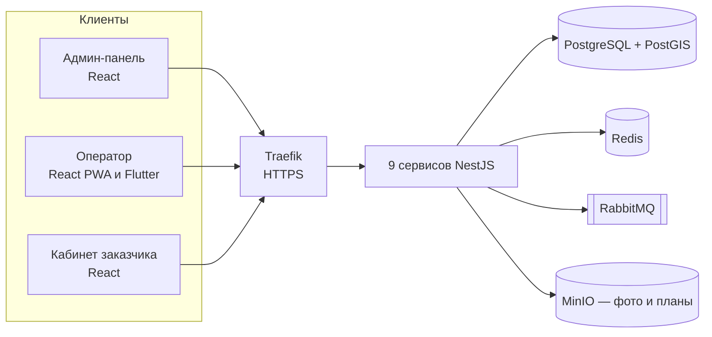

# CLEANFINE — система управления клинингом

CLEANFINE ведёт уборку коммерческих объектов от плана этажа до отчёта заказчику.
Менеджер описывает объект, помещения и техкарты, собирает маршруты и график смен.
Оператор на объекте проходит маршрут с телефона: чек-лист по каждому помещению,
фото до и после, SOS при аварии. Заказчик видит свой объект, оставляет заявки
и переписывается с менеджером. Всё работает в браузере, у каждой роли есть и
отдельное приложение для Android.

**Сайт сервиса:** [aktavest.com](https://aktavest.com/) · **рабочая система:** [cleanfine.ru](https://cleanfine.ru/)

## Кто и где работает

| Роль | В браузере | Приложение для Android |
|---|---|---|
| Администратор, менеджер | [cleanfine.ru](https://cleanfine.ru/) — админ-панель | [CLEANFINE Админ](https://aktavest.com/#admin-app) |
| Оператор, бригадир | [cleanfine.ru/app](https://cleanfine.ru/app) — PWA, ставится на экран «Домой» | [CLEANFINE Оператор](https://aktavest.com/#operator-app) |
| Заказчик | [cleanfine.ru/client](https://cleanfine.ru/client) — личный кабинет | [CLEANFINE Клиент](https://aktavest.com/#client-app) |

Учётные записи выдаёт администратор: открытой регистрации нет. Приложения
скачиваются с сайта [aktavest.com](https://aktavest.com/), раздел CLEANFINE;
телефон попросит разрешить установку из этого источника. Нужен Android 7.0 или
новее; приложение оператора есть и для старых телефонов. Версии для iPhone пока не
раздаются: для этого нужен аккаунт Apple Developer.

## Что умеет система

**Админ-панель**
- Объекты, этажи и помещения на плане этажа; цветовые зоны и экспликация с подсветкой на плане.
- Техкарты и шаблоны: какие операции, каким инвентарём и в каком порядке выполнять в помещении.
- Маршруты обхода и графики смен; часовой пояс организации задаётся в настройках.
- Заявки в любом статусе: назначение, правка, удаление, история; доска действий на главной.
- Сотрудники и роли, карта с геозонами объектов, материалы с остатками и расходом.
- Отчёты по сменам, GPS-трекам и расходу материалов, чат с операторами и заказчиками.

**Рабочее место оператора**
- Смены дня: начало смены проверяется геозоной объекта, конец — по кнопке.
- Маршрут на плане этажа, чек-лист помещения с таймером и фото (не меньше 1280×720).
- SOS: аварийная заявка с фото, описанием и координатами.
- Работа без сети: действия встают в очередь и отправляются, когда связь вернётся.
- Чаты и уведомления; интерфейс на русском, кыргызском и узбекском.

**Кабинет заказчика**
- Только свой объект: статус, ближайшие смены, последние заявки.
- Заявки: создать, отследить, уточнить комментарием.
- Отчёт о расходе материалов, чат с менеджером объекта.

## Приложения

Мобильные приложения собраны из одного Flutter-кода
([`mobile/cleaning-ops-app`](./mobile/cleaning-ops-app)), у каждого своё имя,
иконка и набор экранов (подробно — [`docs/APP_PRODUCTS.md`](./docs/APP_PRODUCTS.md)).

| Приложение | Что внутри | Пакет |
|---|---|---|
| **CLEANFINE Оператор** | смены, маршрут, чек-листы, SOS, работа без сети, GPS, чаты | `com.cleaningops.cleaning_ops_app` |
| **CLEANFINE Клиент** | объект, заявки, чат с менеджером; входит только заказчик | `com.cleaningops.client` |
| **CLEANFINE Админ** | вся админ-панель cleanfine.ru в отдельном приложении; сохранение выгрузок и выбор файлов на телефоне | `com.cleaningops.admin` |

Для компьютера менеджера есть десктоп-обёртка над админ-панелью для macOS и
Windows: [`desktop/manager`](./desktop/manager).

## Как устроено



| Сервис | Порт | Отвечает за |
|---|---|---|
| `auth-service` | 3001 | вход, токены, роли, сотрудники |
| `file-service` | 3002 | фото, планы этажей, документы (MinIO), водяной знак на фото |
| `core-service` | 3003 | объекты, этажи, помещения, техкарты, маршруты |
| `gps-service` | 3004 | GPS-треки и геозоны |
| `ticket-service` | 3005 | заявки и их жизненный цикл |
| `notification-service` | 3006 | уведомления и push |
| `material-service` | 3007 | материалы, остатки, расход |
| `schedule-service` | 3008 | графики, смены, отчёты по сменам, настройки организации |
| `chat-service` | 3009 | чаты (WebSocket и REST) |

У каждого сервиса своя база данных и схема Prisma. Общие типы и константы лежат в
[`shared`](./shared). Прод работает в Kubernetes (k3s), манифесты — в
[`infra/k8s`](./infra/k8s), мониторинг — Grafana ([`infra/grafana`](./infra/grafana)).

**Технологии:** TypeScript, NestJS, Prisma, React + Vite, Flutter, PostgreSQL/PostGIS,
Redis, RabbitMQ, MinIO, Docker, k3s, Traefik. Монорепозиторий на pnpm.

## Структура репозитория

```
backend/            9 микросервисов NestJS
frontend/
  web-admin/        админ-панель
  web-operator/     рабочее место оператора (PWA, /app)
  web-client/       кабинет заказчика (/client)
mobile/
  cleaning-ops-app/ приложения Оператор, Клиент, Админ (Flutter)
desktop/manager/    десктоп-обёртка админ-панели (Electron)
shared/             общие типы, константы, словари переводов
infra/              docker-compose, Kubernetes, Grafana, Terraform
deploy/             сборка образов и выкладка
docs/               документация, API, UAT, архитектура
scripts/            сиды, бэкапы, CI, переводы
```

## Быстрый старт (разработка)

```bash
# 1. Окружение
cp .env.example .env          # заполнить секреты
# 2. Инфраструктура (PostgreSQL+PostGIS, Redis, RabbitMQ, MinIO)
docker compose --env-file .env -f infra/docker/docker-compose.yml up -d
# 3. Зависимости (pnpm 10)
pnpm install
# 4. Контракты shared → dist (обязательно перед сборкой сервисов)
pnpm build:shared
# 5. Проверки
pnpm lint && pnpm typecheck && pnpm test
```

> **Сборка `shared` обязательна перед сборкой и проверкой типов сервисов.** Backend и
> фронтенды берут `@cleaning-ops/shared/*` из `shared/dist`, поэтому контракты
> собираются первыми. `pnpm build` делает это сам: сначала shared, потом остальные пакеты.

> **pnpm.** Нужен pnpm 10: lock-файл формата v9, pnpm 8 его не понимает. Если в
> системе старый pnpm, запускайте
> `npm_config_manage_package_manager_versions=false npx -y pnpm@10 <команда>`:
> переменная не даёт pnpm переключиться на версию из `packageManager`.

Мобильные приложения собираются Flutter'ом с flavor'ом продукта, команды — в
[`docs/APP_PRODUCTS.md`](./docs/APP_PRODUCTS.md).

## Документация

- [`УСТАВ.md`](./УСТАВ.md) — канонические спецификации сервисов и агентов
- [`ПЛАН.md`](./ПЛАН.md) — мастер-план реализации (М0–М7)
- [`КОНТЕКСТ_КОМПАКТ.md`](./КОНТЕКСТ_КОМПАКТ.md) — текущее состояние, решения и журнал работ
- [`docs/APP_PRODUCTS.md`](./docs/APP_PRODUCTS.md) — мобильные приложения и их сборка
- [`docs/COLOR_CODING.md`](./docs/COLOR_CODING.md) — цветовая кодировка зон и инвентаря
- [`docs/api`](./docs/api), [`docs/architecture`](./docs/architecture) — API и архитектура
- [`docs/UAT_PROTOCOL.md`](./docs/UAT_PROTOCOL.md) — приёмочные сценарии по ролям
